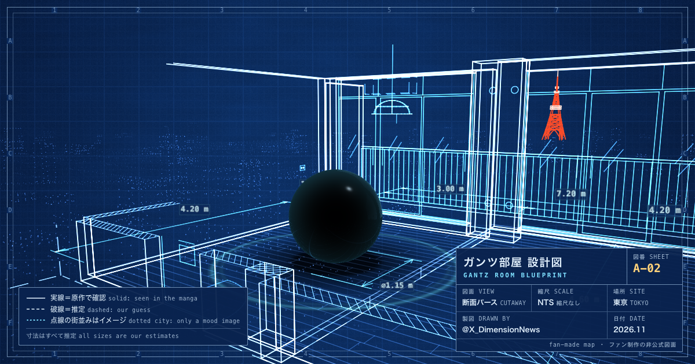

# ガンツ部屋 設計図 ・ GANTZ Room Blueprint

The GANTZ room and its tower as a living blueprint. Fly in from the city, then walk the room: the black sphere, the glass doors with Tokyo Tower outside, the corridor and the front door that will not open. Runs in the browser, no install.

**[Open it →](https://x-dimension-art.github.io/gantz-room-blueprint/)**

## How to read it

| Line | Meaning |
|---|---|
| solid ━━ | 実線＝原作で確認 / seen in the manga |
| dashed ┅┅ | 破線＝推定 / our guess |
| dotted ┈┈ | 点線の街並みはイメージ / the background city is only a mood image |

All sizes are our estimates. Tap a numbered tag to see what it is and where it is in the manga.

## Controls

| Input | Action |
|---|---|
| `外観` `平面図` `断面` `室内` / `1` `2` `3` `4` | Building, plan, cutaway, inside |
| Drag | Orbit (plan: move, inside: look around) |
| Pinch / scroll | Zoom |
| Numbered tag | What it is, seen or guessed, which page |
| `ツアー` | Guided tour, 8 stops |
| `人型` | 1.70 m scale figure on or off |
| `音` | Sound on or off |

---

Unofficial, non-commercial fan work. GANTZ is created by Hiroya Oku (奥浩哉). fan-made map by @X_DimensionNews.
